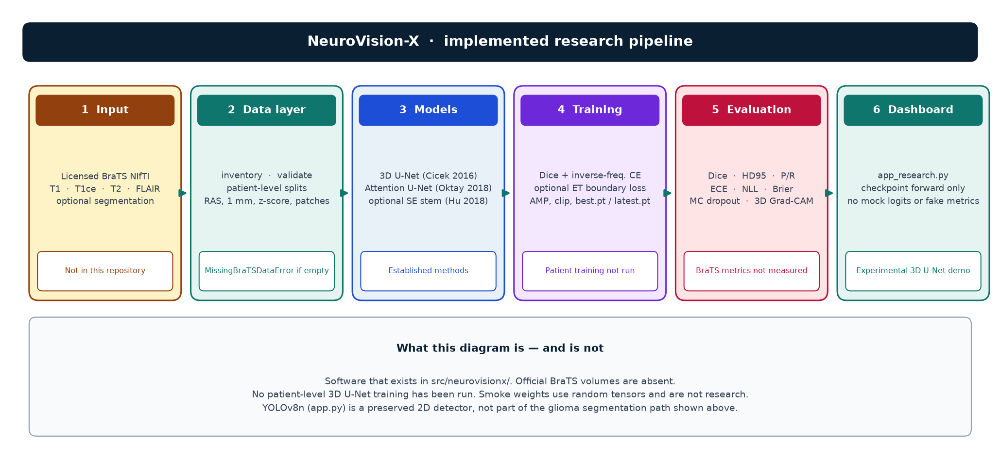
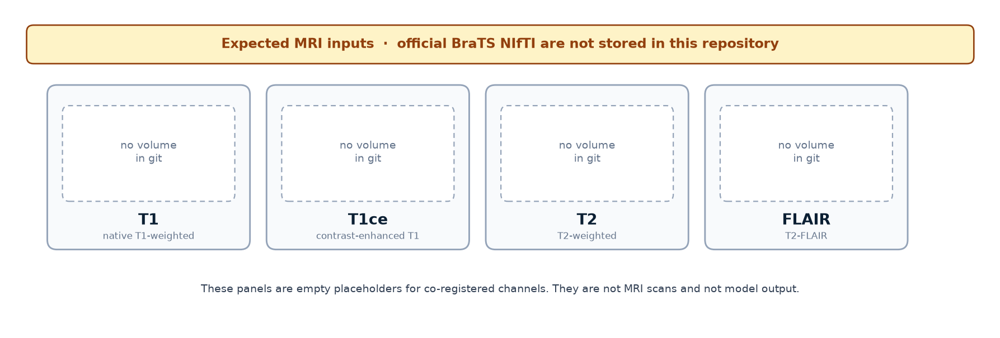
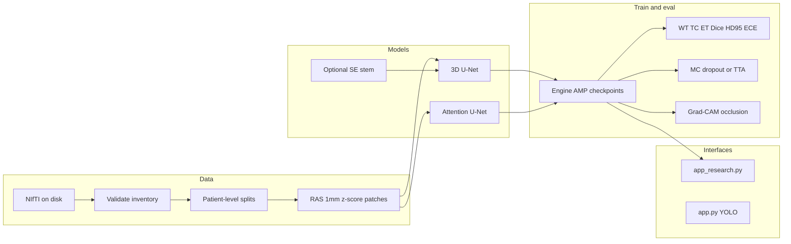
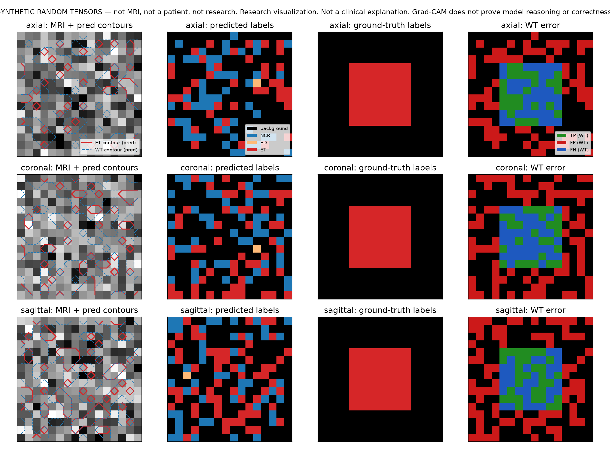

# NeuroVision-X

[](https://www.python.org/)
[](https://pytorch.org/)
[](https://monai.io/)
[](LICENSE)
[](tests/)
[](https://github.com/Shaiza666/neurovision-x)

**Reproducible 3D glioma MRI segmentation research software** (PyTorch / MONAI), plus a preserved local YOLOv8n detector.

[Documentation](docs/README.md) · [Research report](docs/research_report.md) · [Architecture](docs/architecture.md) · [Dataset guide](docs/dataset.md) · [Training](docs/training.md) · [Evaluation](docs/evaluation.md) · [Slides](docs/presentation.md)

> **Research prototype — not a clinically validated diagnostic system.**  
> Do not use these outputs for diagnosis or treatment. This repository is **not** a published paper. No conference acceptance, award, or BraTS leaderboard entry is claimed.

---

## Contents

- [Overview](#overview)
- [Current status](#current-status)
- [Research objectives](#research-objectives)
- [Key features](#key-features)
- [Architecture](#architecture)
- [Technical workflow](#technical-workflow)
- [Technology stack](#technology-stack)
- [Repository layout](#repository-layout)
- [Installation](#installation)
- [Dashboards](#dashboards)
- [Testing](#testing)
- [Documentation map](#documentation-map)
- [Limitations](#limitations)
- [Future work](#future-work)
- [Citation and license](#citation-and-license)
- [Author](#author)

---

## Overview

NeuroVision-X is a **matched, config-driven protocol** for 3D glioma sub-region segmentation on co-registered T1, T1ce, T2, and FLAIR MRI. The stack implements established methods only: 3D U-Net, Attention U-Net, optional Squeeze-and-Excitation fusion, a Kervadec boundary term on enhancing tumor (ET), Monte Carlo dropout, flip test-time augmentation, nested WT / TC / ET metrics, calibration scores, and Grad-CAM / occlusion overlays.

The intended scientific contribution is the **joint reliability study** (hypotheses H1–H2) on **licensed BraTS** data. That study **has not been run**. Official volumes are not in this tree. A preserved YOLOv8n Streamlit app lives beside the 3D research path and is **not** a glioma segmenter.

Full abstract: [`docs/abstract.md`](docs/abstract.md).

---

## Current status

| Item | State in this repository |
| --- | --- |
| Official BraTS NIfTI | **Absent** (`data/raw/brats/` is a README) |
| WT / TC / ET Dice, HD95, ECE on patients | **Not measured** |
| Ablations A0–A5 on patients | **Not trained** |
| Hypotheses H1 / H2 | **Untested** |
| H3 (CNN vs transformer) | **Deferred** (CPU-only machine recorded; `unetr` raises `NotImplementedError`) |
| Smoke job | 2 epochs on **random tensors**, CPU — **not research** |
| Unit tests | **116 collected** (115 passed, 1 skipped when MONAI is installed) |
| Research UI | `app_research.py` — real checkpoint forward only |
| YOLO UI | `app.py` — preserved 2D detector demo |

Details: [`docs/experimental_results.md`](docs/experimental_results.md).

---

## Research objectives

| ID | Question | Status |
| --- | --- | --- |
| **H1** | Does an ET boundary term reduce ET HD95 vs matched Dice+CE without a Dice drop beyond a 1-point margin? | Protocol coded; **no BraTS result** |
| **H2** | Does patient-level MC / TTA entropy detect failed cases better than voxel maps? | Code exists; **untested on patients** |
| **H3** | Is a matched 3D U-Net competitive with UNETR / Swin UNETR at similar compute? | **Deferred** until a GPU comparison is approved |

All modelling blocks are **established methods**. Novelty, if any, would be the controlled protocol and the measurements it produces after licensed data and protocol approval.

---

## Key features

| Area | Implemented |
| --- | --- |
| **Data** | BraTS 2021 / 2023 filename tokens, RAS + 1 mm resample, non-zero z-score, patient-level splits, leakage checks. Missing modalities are errors, not zeros. |
| **Models** | In-repo 3D U-Net and Attention U-Net; optional SE stem; optional MONAI nets; factory-driven YAML. |
| **Training** | AdamW, AMP when CUDA exists, early stopping, resume, `best.pt` / `latest.pt`, optional plateau scheduler. Official jobs **refuse** without BraTS. |
| **Metrics** | Nested WT / TC / ET Dice, HD95, precision, sensitivity, specificity, ECE, NLL, Brier, mean ± std and t-intervals, CSV + JSON. |
| **Uncertainty** | MC dropout and flip TTA; patient-level aggregation for H2. |
| **Explainability** | 3D Grad-CAM, occlusion, orthogonal overlays. Not clinical explanations. |
| **Apps** | Research dashboard (`app_research.py`) and YOLO detector (`app.py`). |
| **Honesty gates** | Smoke folders never fill A/B/C tables. `MissingBraTSDataError` instead of fake MRI. |

---

## Architecture

The figure documents the **implemented** research workflow. It is not a claim that BraTS training has been run.



Baseline backbone: **3D U-Net** (Çiçek et al., 2016) in `src/neurovisionx/models/unet3d.py` — 4 MRI channels, 4 classes (background, NCR, ED, ET), YAML features `[16, 32, 64, 128]`. Attention U-Net and an SE stem are config alternatives.


Module map: [`docs/architecture.md`](docs/architecture.md).

Official BraTS NIfTI is **not** stored in git. The loader expects four co-registered channels. Empty panels below are **placeholders**, not scans.



---

## Technical workflow

GitHub-safe Mermaid (no HTML in nodes). Licensed NIfTI is an **input the user must provide**; it is not bundled.



Missing BraTS folders stop the patient path with `MissingBraTSDataError`. The research UI never invents logits. YOLO (`app.py`) is a separate 2D demo and is not on this path.

---

## Technology stack

| Layer | Tools |
| --- | --- |
| Language | Python ≥ 3.10 (developed on 3.12.10) |
| 3D research | PyTorch, MONAI (optional), NiBabel, SciPy, Matplotlib |
| Apps | Streamlit, OpenCV, ONNX Runtime |
| Config | YAML (`configs/`) |
| Tests | `unittest` (`tests/`) |

Package `neurovisionx` **0.9.0** lives under `src/`. The YOLO package is `neurovision_x/` (underscore) at the repo root.

---

## Repository layout

```text
assets/            README diagrams (no patient MRI)
configs/           data, model, training, ablations, evaluation YAML
data/              raw / processed / splits (no NIfTI in git)
src/neurovisionx/  3D segmentation package
neurovision_x/     preserved YOLOv8n detector
app.py             YOLO Streamlit UI
app_research.py    3D research dashboard
docs/              report, slides, protocols, bibliography
experiments/       run folders (gitignored weights; README only)
notebooks/
scripts/           train, evaluate, explain, collect_results, …
tests/
```

---

## Installation

Python ≥ 3.10. Full guide: [`docs/installation.md`](docs/installation.md).

```powershell
git clone https://github.com/Shaiza666/neurovision-x.git
cd neurovision-x
py -3.12 -m venv .venv
.\.venv\Scripts\python -m pip install --upgrade pip
.\.venv\Scripts\python -m pip install -e ".[research]"
.\.venv\Scripts\python -m pip install -e ".[app]"
.\.venv\Scripts\python -m unittest discover -s tests
```

Hardware check (does not train):

```powershell
.\.venv\Scripts\python scripts\check_resources.py
```

---

## Dashboards

### Research demo (3D U-Net)

Predictions come only from a loaded `.pt`. No mock logits.

```powershell
.\.venv\Scripts\python -m streamlit run app_research.py
```

If only `experiments/smoke/` exists, use the labelled **interface test** (random tensor + real smoke weights). That is **not MRI**.

Guide: [`docs/demo.md`](docs/demo.md). Walkthrough: [`docs/demo_script.md`](docs/demo_script.md).

**Layout demo (random tensors, not a patient):**



### YOLO detector (2D, preserved)

```powershell
.\.venv\Scripts\python -m streamlit run app.py
```

This path does not compute WT / TC / ET Dice.

### Capture still needed

Live Streamlit screenshots of `app_research.py` and `app.py` are **not** in git. After a local run, save honest captures (with the smoke / not-clinical banner visible) under `docs/figures/dashboards/` if you want them on GitHub. Do not screenshot fabricated MRI.

---

## Testing

Last verified locally: **116 collected**, **115 passed**, **1 skipped** (`test_missing_monai_is_explicit` when MONAI is installed), **0 failed**.

```powershell
.\.venv\Scripts\python -m unittest discover -s tests
```

Fixtures use synthetic tensors or tiny NIfTI — **not** medical data.

There is no GitHub Actions workflow in this repository; the test badge is the last local count, not live CI.

---

## Documentation map

| Topic | File |
| --- | --- |
| Index | [docs/README.md](docs/README.md) |
| Report | [docs/research_report.md](docs/research_report.md) |
| Dataset (Synapse; no auto-download) | [docs/dataset.md](docs/dataset.md) |
| Train / eval | [docs/training.md](docs/training.md), [docs/evaluation.md](docs/evaluation.md) |
| Protocol | [docs/experimental_protocol.md](docs/experimental_protocol.md) |
| Hypotheses | [docs/research_hypotheses.md](docs/research_hypotheses.md) |
| Reproducibility | [docs/reproducibility.md](docs/reproducibility.md) |
| References | [docs/references.md](docs/references.md) |
| Slides | [docs/presentation.md](docs/presentation.md) |
| Portfolio | [docs/portfolio_summary.md](docs/portfolio_summary.md) |

BraTS training (exits until licensed NIfTI **and** protocol approval):

```powershell
.\.venv\Scripts\python scripts\validate_dataset.py
.\.venv\Scripts\python scripts\prepare_splits.py
.\.venv\Scripts\python scripts\ablation_plan.py
.\.venv\Scripts\python scripts\train.py --ablation A0_baseline --run-name A0_baseline
.\.venv\Scripts\python scripts\evaluate.py --run-name A0_baseline
.\.venv\Scripts\python scripts\collect_results.py
```

---

## Limitations

- Not a diagnostic device; Grad-CAM and entropy maps are research QC, not clinical explanations.
- No official BraTS volumes in git; challenge metrics are **not measured**.
- Smoke Dice on random cubes is **not** a BraTS score (see experimental results if a local smoke job exists).
- H3 transformers are unimplemented until a matched GPU protocol is approved.
- YOLO is a separate 2D demo, not glioma segmentation.

---

## Future work

1. Accept the BraTS / Synapse license and unpack glioma NIfTI under `data/raw/brats/` ([dataset guide](docs/dataset.md)).
2. Freeze patient splits; approve [`docs/experimental_protocol.md`](docs/experimental_protocol.md).
3. Train **A0** on a CUDA machine (≥16 GB RAM recommended), then evaluate and run H2 (A4) on A0 weights.
4. Train **A3** for H1 if compute remains; then A1 / A2 / A5.
5. Revisit H3 only under a matched GPU budget.
6. Optional: capture labelled dashboard screenshots for this README.

Negative H1 / H2 outcomes will be reported if those jobs run. They will not be invented.

---

## Citation and license

MIT. See [LICENSE](LICENSE). Cite the **software repository**, not a fictional article:

```bibtex
@software{neurovisionx2026,
  title        = {NeuroVision-X: a reproducible 3D glioma MRI segmentation research stack},
  author       = {Asghar, Shaiza},
  year         = {2026},
  url          = {https://github.com/Shaiza666/neurovision-x},
  note         = {Experimental prototype. Not a clinically validated diagnostic system.}
}
```

Also [CITATION.cff](CITATION.cff).

---

## Author

**Shaiza Asghar** ([Shaiza666](https://github.com/Shaiza666))  
Repository: [https://github.com/Shaiza666/neurovision-x](https://github.com/Shaiza666/neurovision-x)
