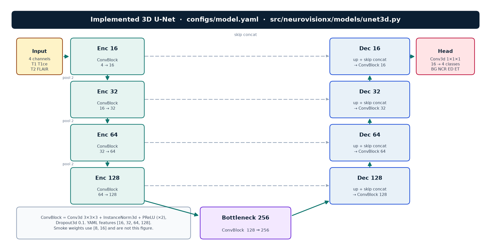

# NeuroVision-X

Reproducible **3D glioma MRI segmentation** research stack (PyTorch / MONAI), plus a preserved local **YOLOv8n** detector.

[Documentation](docs/README.md) · [Dataset](docs/dataset.md) · [Training](docs/training.md) · [Evaluation](docs/evaluation.md) · [Research report](docs/research_report.md) · [Architecture](docs/architecture.md)

**This software is an experimental research prototype. It is not a clinically validated diagnostic system. Do not use it for diagnosis or treatment decisions.**

It is **not** a published paper. No conference acceptance, award, or BraTS leaderboard entry is claimed.

## Status (honest)

| Item | State in this repository |
| --- | --- |
| Official BraTS NIfTI | **Absent** (`data/raw/brats/` is a README) |
| BraTS A / B / C Dice, HD95, ECE | **Not measured** |
| Ablations A0–A5 on patients | **Not trained** |
| Hypotheses H1 / H2 | **Untested** |
| H3 (CNN vs transformer) | **Deferred** (`cuda: false` on the recorded machine) |
| Smoke job (random tensors) | 2 epochs, CPU, PyTorch 2.15.0+cpu — **not research** |
| Unit tests | 116 collected |
| Research dashboard | `app_research.py` — real checkpoints only |

Details: [`docs/experimental_results.md`](docs/experimental_results.md).

## Abstract

NeuroVision-X implements a **matched protocol** for 3D U-Net and Attention U-Net, optional Squeeze-and-Excitation fusion, a Kervadec boundary term on enhancing tumor, Monte Carlo dropout, nested WT/TC/ET metrics, calibration scores, and Grad-CAM overlays. Every modelling piece is an **established** method. The intended scientific contribution is the joint reliability study on licensed BraTS data — a study that **has not been run**, because official volumes are not in this tree. Full abstract: [`docs/abstract.md`](docs/abstract.md).

## Architecture

The figure below is the **implemented** research workflow. It is not a claim that BraTS training or evaluation has been run.


Module map: [`docs/architecture.md`](docs/architecture.md).

## MRI examples

Official BraTS NIfTI volumes are **not** in this repository (`data/raw/brats/` is a README only). The pipeline expects four co-registered channels: T1, T1ce, T2, and FLAIR. **No genuine patient MRI is shown here**, because none is stored in git.


## Model architecture

Baseline backbone: **3D U-Net** (Çiçek et al., 2016) as implemented in `src/neurovisionx/models/unet3d.py`, with `in_channels=4`, `out_channels=4` (background, NCR, ED, ET), and YAML features `[16, 32, 64, 128]`. Attention U-Net and an optional SE stem are config alternatives. This figure documents the **code**, not a trained BraTS model.



A smoke checkpoint trained on **random tensors** (2 epochs, CPU, features `[8, 16]`) may exist locally. That is a software check, not this architecture trained on MRI.

## Segmentation results

No BraTS-trained 3D U-Net checkpoint is in this tree. Patient-level Dice, HD95, and ECE have **not been measured**. Segmentation overlays on real MRI are therefore **omitted** rather than simulated.

| Comparison | Dice WT | Dice TC | Dice ET | HD95 | ECE |
| --- | --- | --- | --- | --- | --- |
| A 3D U-Net | not measured | not measured | not measured | not measured | not measured |
| B Attention U-Net | not measured | not measured | not measured | not measured | not measured |
| C SE + ET boundary + MC | not measured | not measured | not measured | not measured | not measured |

Smoke (random tensors, 2 epochs, CPU): synthetic val Dice WT/TC/ET ≈ 0.034 / 0.024 / 0.001. That is **not** a challenge score and is not an MRI prediction. Details: [`docs/experimental_results.md`](docs/experimental_results.md).

## Repository layout

```
assets/            README diagrams (no patient MRI)
configs/           data, model, training, ablations, evaluation YAML
data/              raw / processed / splits (no NIfTI in git)
src/neurovisionx/  3D segmentation package
neurovision_x/     preserved YOLOv8n detector
app.py             YOLO Streamlit UI
app_research.py    3D research dashboard
docs/              report, slides, protocols, bibliography
experiments/       run folders (gitignored weights; README only)
notebooks/
scripts/           train, evaluate, explain, collect_results, …
tests/
```

## Installation

Python ≥ 3.10 (developed on 3.12.10). Full guide: [`docs/installation.md`](docs/installation.md).

```powershell
git clone https://github.com/Shaiza666/neurovision-x.git
cd neurovision-x
py -3.12 -m venv .venv
.\.venv\Scripts\python -m pip install --upgrade pip
.\.venv\Scripts\python -m pip install -e ".[research]"
.\.venv\Scripts\python -m pip install -e ".[app]"
.\.venv\Scripts\python -m unittest
```

## Usage

**Research dashboard** (predictions come only from a loaded `.pt`; no mock logits):

```powershell
.\.venv\Scripts\python -m streamlit run app_research.py
```

If only the smoke checkpoint exists, use the labelled **interface test** (random tensor + real smoke weights). That is not MRI.

**YOLOv8 detector** (unchanged 2D demo):

```powershell
.\.venv\Scripts\python -m streamlit run app.py
```

**Smoke training** (software check, not BraTS):

```powershell
.\.venv\Scripts\python scripts\smoke_train.py
```

**BraTS path** — exits until licensed volumes sit under `data/raw/brats/` **and** [`docs/experimental_protocol.md`](docs/experimental_protocol.md) is approved:

```powershell
.\.venv\Scripts\python scripts\validate_dataset.py
.\.venv\Scripts\python scripts\prepare_splits.py
.\.venv\Scripts\python scripts\ablation_plan.py
.\.venv\Scripts\python scripts\train.py --ablation A0_baseline --run-name A0_baseline
.\.venv\Scripts\python scripts\evaluate.py --run-name A0_baseline
.\.venv\Scripts\python scripts\collect_results.py
```

Reproducibility notes: [`docs/reproducibility.md`](docs/reproducibility.md). Demonstration walkthrough: [`docs/demo_script.md`](docs/demo_script.md).

## Documentation

| Topic | File |
| --- | --- |
| Full report (intro → conclusion) | [docs/research_report.md](docs/research_report.md) |
| Abstract | [docs/abstract.md](docs/abstract.md) |
| Related work | [docs/literature_review.md](docs/literature_review.md) |
| Gap and hypotheses | [docs/research_gap.md](docs/research_gap.md), [docs/research_hypotheses.md](docs/research_hypotheses.md) |
| Mathematics | [docs/proposed_method.md](docs/proposed_method.md), [docs/metrics.md](docs/metrics.md) |
| Protocol | [docs/experimental_protocol.md](docs/experimental_protocol.md) |
| Architecture | [docs/architecture.md](docs/architecture.md) |
| Install / reproduce | [docs/installation.md](docs/installation.md), [docs/reproducibility.md](docs/reproducibility.md) |
| References (IEEE) | [docs/references.md](docs/references.md) |
| Slides / demo script | [docs/presentation.md](docs/presentation.md), [docs/demo_script.md](docs/demo_script.md) |
| Portfolio summary | [docs/portfolio_summary.md](docs/portfolio_summary.md) |
| Index of all docs | [docs/README.md](docs/README.md) |

## License and citation

MIT. See [LICENSE](LICENSE). Cite the **software repository**, not a fictional article:

```bibtex
@software{neurovisionx2026,
  title        = {NeuroVision-X: a reproducible 3D glioma MRI segmentation research stack},
  author       = {Asghar, Shaiza},
  year         = {2026},
  url          = {https://github.com/Shaiza666/neurovision-x},
  note         = {Experimental prototype. Not a clinically validated diagnostic system.}
}
```

Also [CITATION.cff](CITATION.cff).
