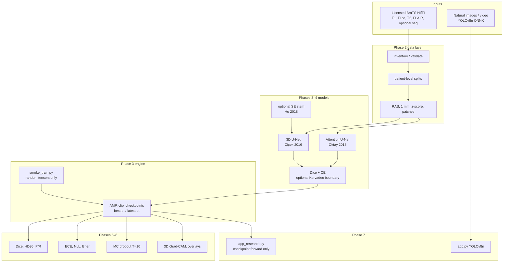

# System architecture

**Research prototype. Not a clinically validated diagnostic system.**

This diagram describes the **implemented** software. Official BraTS volumes are not in the repository. Training on patients has not been run. The smoke path uses random tensors and is excluded from research tables.

## Pipeline

Missing BraTS folders stop the patient path with `MissingBraTSDataError`. The UI does not invent logits.

## Package map (`src/neurovisionx/`)

| Package | Role |
| --- | --- |
| `data/` | NIfTI discovery, validation, patient splits, z-score, patches, signed distance |
| `models/` | 3D U-Net, Attention U-Net, optional SE wrapper, factory |
| `losses/` | Soft Dice, inverse-frequency CE, Kervadec boundary |
| `training/` | Engine, checkpoints, smoke loaders, curves |
| `evaluation/` | Sliding-window inference, nested regions, metrics, cost |
| `uncertainty/` | MC dropout, calibration tables |
| `explainability/` | Grad-CAM, orthogonal views, overlays, 3D preview |
| `experiments/` | Ablation catalog, result collection from JSON |
| `demo/` | Checkpoint load, upload validation, dashboard inference |
| `utils/` | YAML config, seeds, run metadata |

The YOLOv8 detector lives in `neurovision_x/` (underscore) and `app.py`. It is a preserved local demo, not a glioma segmenter.

## What is not in the architecture

- UNETR / Swin UNETR (H3 deferred; factory raises `NotImplementedError`)
- Automatic BraTS download
- A clinical PACS / DICOM diagnostic workflow
- Fabricated `metrics_test.json`
