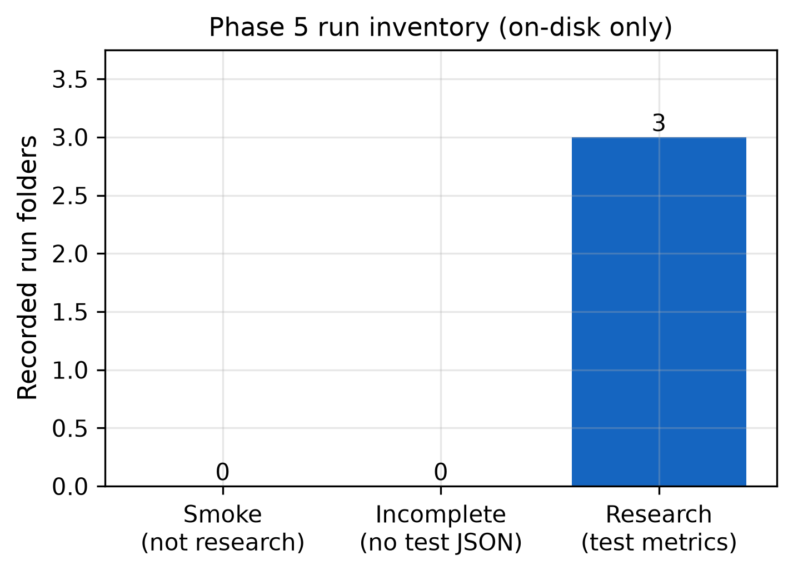
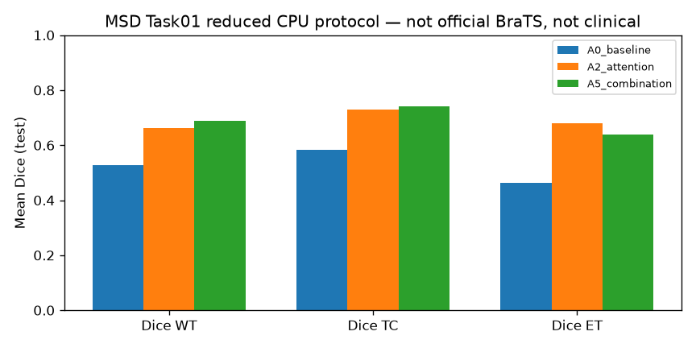
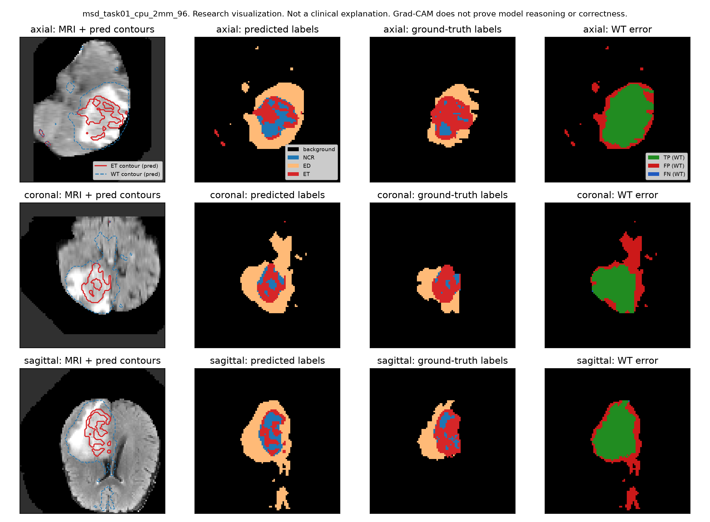
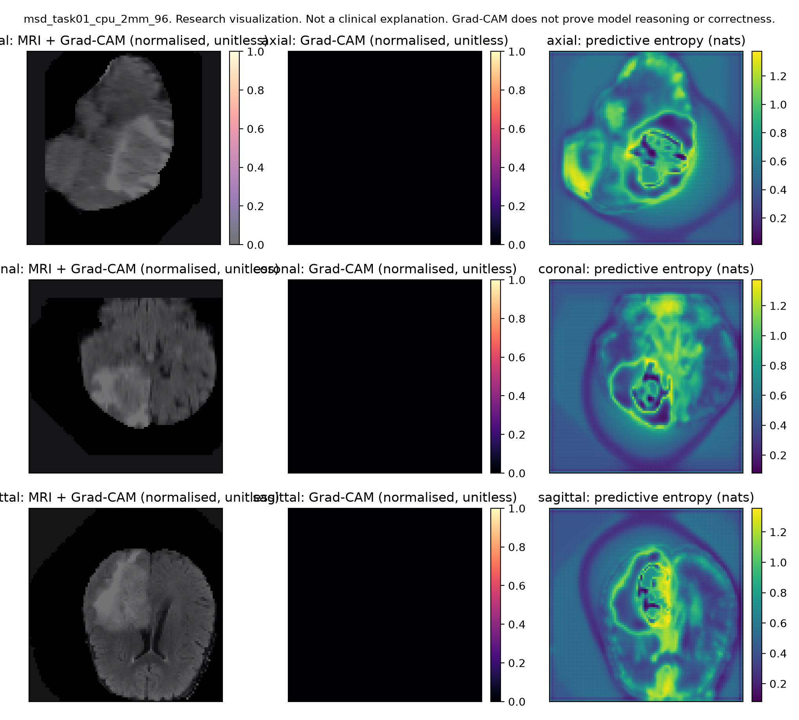
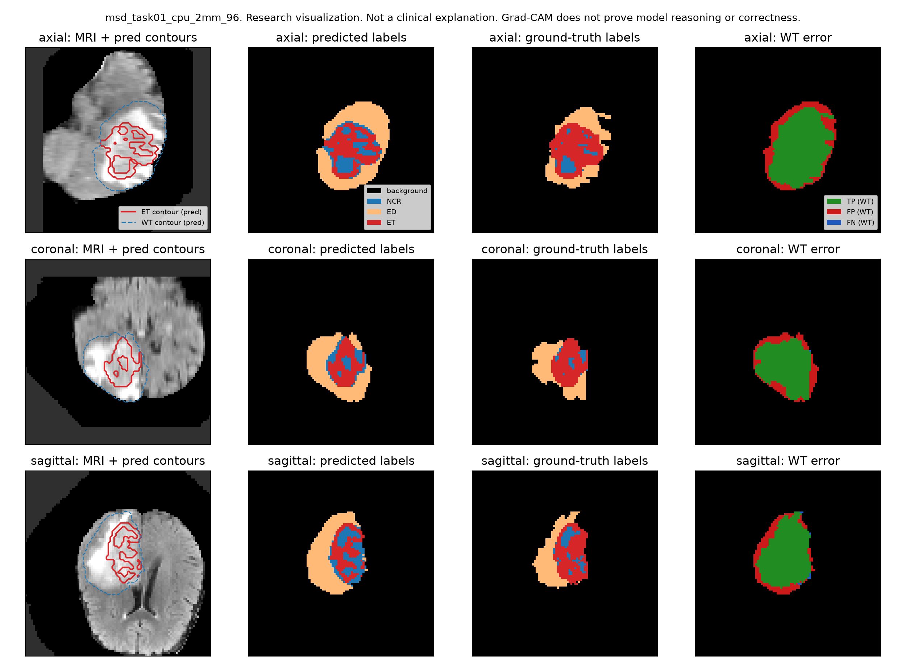
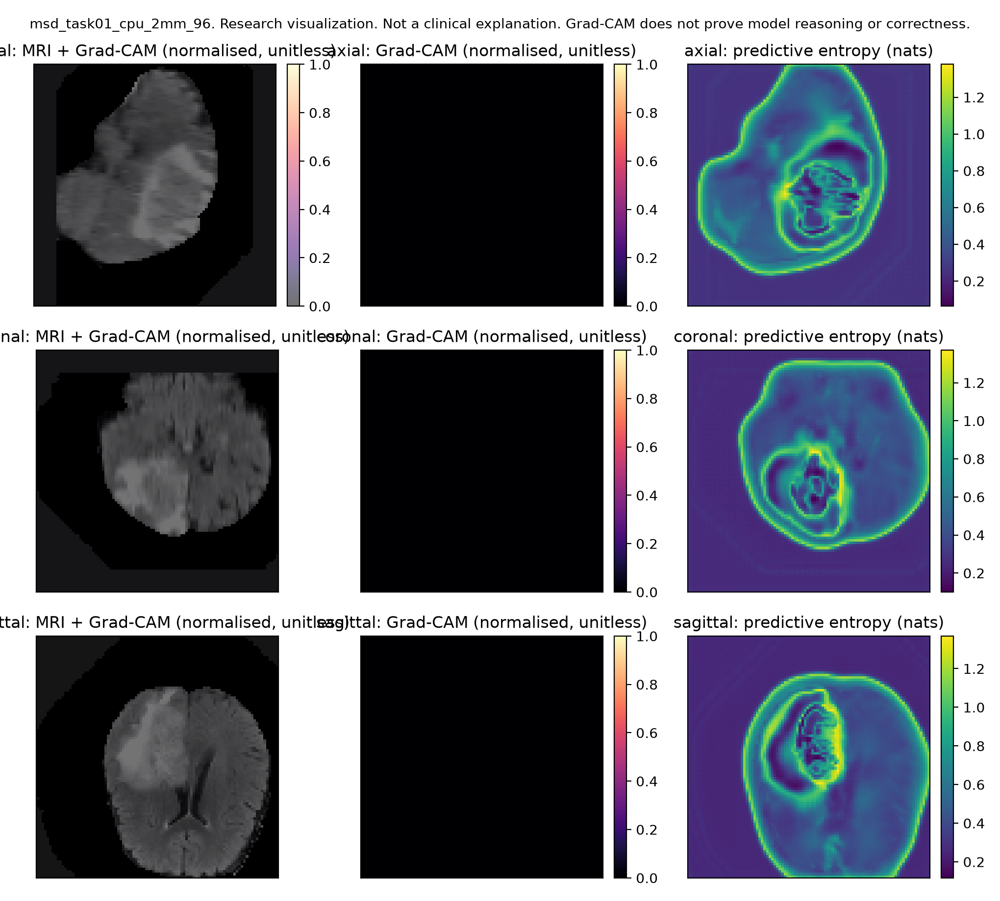
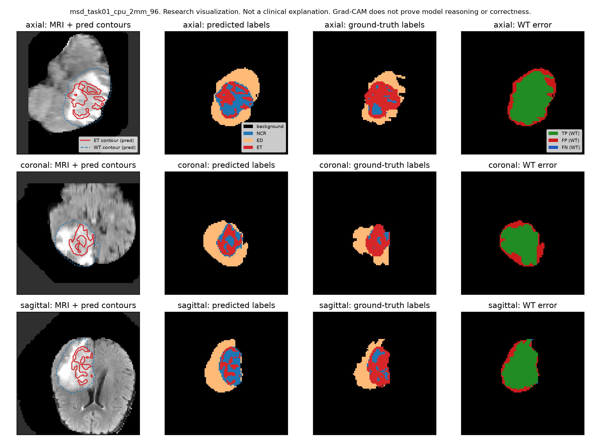
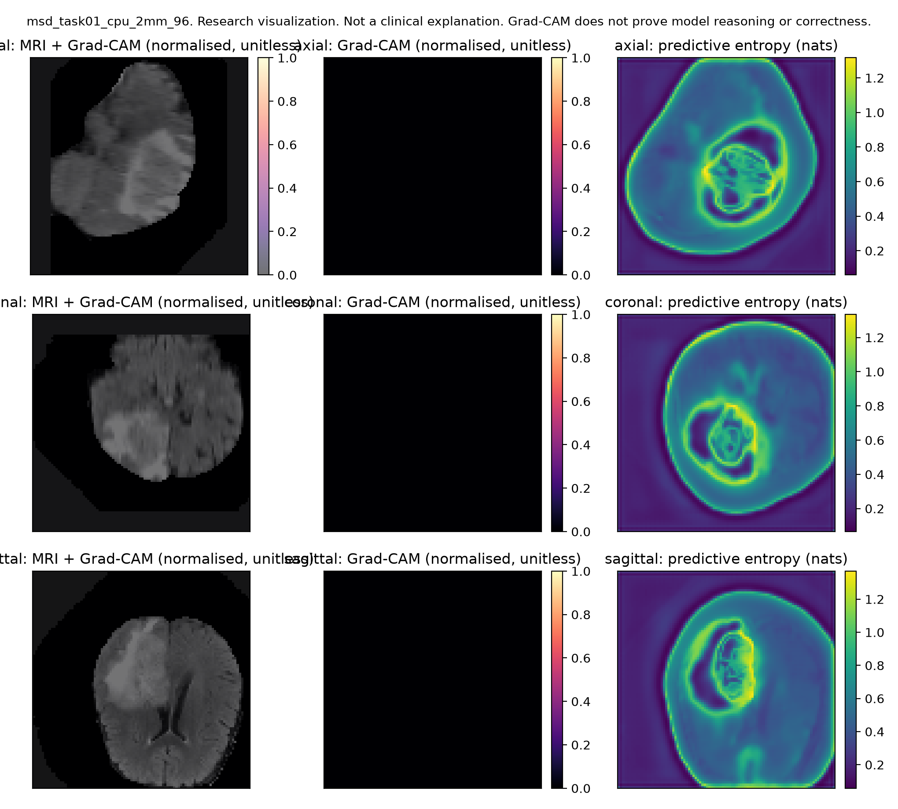
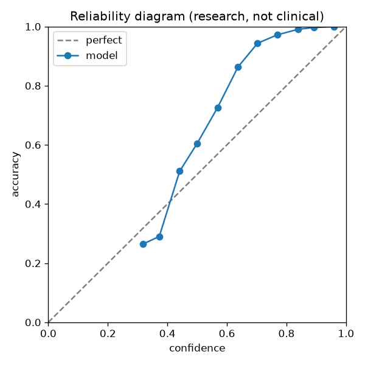
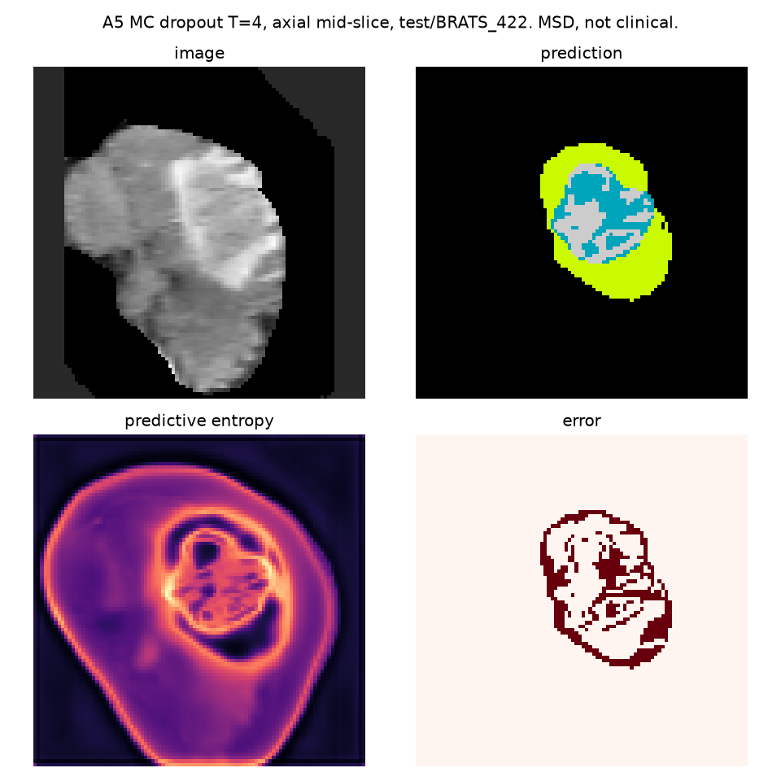

# Experimental results (Phase 5)

**This software is a research prototype, not a clinically validated diagnostic tool.**

Generated: `2026-11-21T14:13:40.292889+00:00` from on-disk `experiments/` JSON only. Missing measurements are written as **not measured**. No leaderboard number, no paper table, and no synthetic smoke Dice was copied into the comparison tables.

## Verdict on recorded evidence

- Research-eligible test evaluations (non-smoke `metrics_test.json`): **3**
- Synthetic smoke folders: **0**
- Official BraTS / Synapse A vs B vs C comparison: **not measured**.
- Research-eligible runs present: 3. Numbers below are from those files only. They are not a leaderboard entry.
- No improvement of the proposed method over the baseline is claimed.

## Dataset on disk for these runs

- `A0_baseline`: `msd_task01_cpu_2mm_96` — Deterministic subset of the seed-2026 MSD Task01 patient split, resampled to 2 mm isotropic, foreground-cropped, then center-cropped or padded to 96×96×96. Not official BraTS. Not clinically validated.
  - Protocol reductions: No GPU. Versus configs/training.yaml and configs/model.yaml: spacing 2 mm instead of 1 mm; spatial size fixed at 96³ after foreground crop (native BraTS grid is about 240×240×155); U-Net widths [8, 16, 32, 64] instead of [16, 32, 64, 128]; AdamW lr 1e-3 instead of 1e-4; 25 epochs instead of 50; a prefix of the seed-2026 split (48 train / 8 val / 12 test) instead of every labeled MSD case; AMP off; in-repo networks (optional_monai false). HD95 from scripts/evaluate.py is in voxels of this 2 mm grid.
  - License: CC-BY-SA 4.0 (Medical Segmentation Decathlon Task01). Volumes are gitignored.
- `A2_attention`: `msd_task01_cpu_2mm_96` — Deterministic subset of the seed-2026 MSD Task01 patient split, resampled to 2 mm isotropic, foreground-cropped, then center-cropped or padded to 96×96×96. Not official BraTS. Not clinically validated.
  - Protocol reductions: No GPU. Versus configs/training.yaml and configs/model.yaml: spacing 2 mm instead of 1 mm; spatial size fixed at 96³ after foreground crop (native BraTS grid is about 240×240×155); U-Net widths [8, 16, 32, 64] instead of [16, 32, 64, 128]; AdamW lr 1e-3 instead of 1e-4; 25 epochs instead of 50; a prefix of the seed-2026 split (48 train / 8 val / 12 test) instead of every labeled MSD case; AMP off; in-repo networks (optional_monai false). HD95 from scripts/evaluate.py is in voxels of this 2 mm grid.
  - License: CC-BY-SA 4.0 (Medical Segmentation Decathlon Task01). Volumes are gitignored.
- `A5_combination`: `msd_task01_cpu_2mm_96` — Deterministic subset of the seed-2026 MSD Task01 patient split, resampled to 2 mm isotropic, foreground-cropped, then center-cropped or padded to 96×96×96. Not official BraTS. Not clinically validated.
  - Protocol reductions: No GPU. Versus configs/training.yaml and configs/model.yaml: spacing 2 mm instead of 1 mm; spatial size fixed at 96³ after foreground crop (native BraTS grid is about 240×240×155); U-Net widths [8, 16, 32, 64] instead of [16, 32, 64, 128]; AdamW lr 1e-3 instead of 1e-4; 25 epochs instead of 50; a prefix of the seed-2026 split (48 train / 8 val / 12 test) instead of every labeled MSD case; AMP off; in-repo networks (optional_monai false). HD95 from scripts/evaluate.py is in voxels of this 2 mm grid.
  - License: CC-BY-SA 4.0 (Medical Segmentation Decathlon Task01). Volumes are gitignored.

These rows are **not** an official BraTS / Synapse leaderboard comparison. MSD Task01 is BraTS 2016/2017-derived and CC-BY-SA 4.0. This software is not a clinically validated diagnostic tool.

## Actual recorded runs

| Folder | Status | Smoke? | Test metrics? | Device | CUDA | Epochs |
| --- | --- | --- | --- | --- | --- | --- |
| A0_baseline | completed | no | yes | cpu | False | 25.0 |
| A2_attention | completed | no | yes | cpu | False | 25.0 |
| A5_combination | completed | no | yes | cpu | False | 25.0 |



*Figure 1. Count of folders that actually exist. Not a performance chart.*

## Comparison (A / B / C)

Cells stay empty until the named run has a non-smoke `metrics_test.json`. When a run's dataset block names a reduced protocol, these cells are that protocol, not the 1 mm BraTS schedule in `docs/evaluation_protocol.md`.

| Metric | A: 3D U-Net baseline | B: Attention U-Net | C: Proposed (SE + ET boundary + MC dropout) |
| --- | --- | --- | --- |
| Dice WT | 0.528 ± 0.238 [0.377, 0.679] (n=12) | 0.662 ± 0.190 [0.541, 0.783] (n=12) | 0.690 ± 0.154 [0.592, 0.788] (n=12) |
| Dice TC | 0.583 ± 0.202 [0.454, 0.711] (n=12) | 0.729 ± 0.149 [0.634, 0.824] (n=12) | 0.740 ± 0.143 [0.650, 0.831] (n=12) |
| Dice ET | 0.464 ± 0.281 [0.285, 0.642] (n=12) | 0.680 ± 0.257 [0.517, 0.843] (n=12) | 0.638 ± 0.253 [0.477, 0.799] (n=12) |
| HD95 WT | 26.575 ± 11.197 [19.461, 33.689] (n=12) | 9.203 ± 7.775 [4.263, 14.143] (n=12) | 13.176 ± 10.727 [6.360, 19.991] (n=12) |
| HD95 TC | 32.714 ± 10.189 [26.240, 39.188] (n=12) | 12.081 ± 12.182 [4.340, 19.821] (n=12) | 12.153 ± 15.035 [2.600, 21.705] (n=12) |
| HD95 ET | 31.378 ± 10.962 [24.014, 38.742] (n=11) | 7.933 ± 11.982 [-0.117, 15.983] (n=11) | 4.441 ± 6.099 [0.344, 8.539] (n=11) |
| Precision ET | 0.421 ± 0.286 [0.239, 0.603] (n=12) | 0.659 ± 0.294 [0.472, 0.845] (n=12) | 0.755 ± 0.319 [0.553, 0.958] (n=12) |
| Recall ET | 0.571 ± 0.275 [0.396, 0.746] (n=12) | 0.746 ± 0.259 [0.581, 0.910] (n=12) | 0.593 ± 0.248 [0.435, 0.751] (n=12) |
| ECE | 0.109 ± 0.014 [0.100, 0.118] (n=12) | 0.075 ± 0.005 [0.073, 0.078] (n=12) | 0.081 ± 0.004 [0.079, 0.083] (n=12) |
| Brier (multiclass) | 0.066 ± 0.017 [0.055, 0.077] (n=12) | 0.041 ± 0.008 [0.036, 0.046] (n=12) | 0.040 ± 0.006 [0.036, 0.044] (n=12) |

### Additional planned metrics

| Metric | Status |
| --- | --- |
| Small-ET Dice (lowest quartile of ET voxels) | see reliability JSON |
| Spearman ρ (patient entropy vs ET Dice) | see reliability JSON |
| AUPRC for worst ET Dice quartile | see reliability JSON |
| Inference latency (ms, T=1 and T=10) | see reliability JSON |
| GPU peak allocated MB | see reliability JSON |

## Component ablations (from C)

Each arm removes one proposed component. None of these jobs has been started unless a matching non-smoke folder exists.

| Arm | Removes | Train? | dice_et |
| --- | --- | --- | --- |
| C_minus_se | SE fusion | no (reuse ckpt) | not measured |
| C_minus_boundary | ET boundary loss | no (reuse ckpt) | not measured |
| C_minus_mc | MC dropout | no (reuse ckpt) | not measured |

## Failure cases

Lowest ET Dice on the recorded test split (not a clinical list):

| patient_id | dice_et | hd95_et | et_voxels |
| --- | --- | --- | --- |
| test/BRATS_026 | 0.000 | NaN |  |
| test/BRATS_133 | 0.333 | 4.123 |  |
| test/BRATS_448 | 0.529 | 4.685 |  |
| test/BRATS_289 | 0.608 | 22.219 |  |
| test/BRATS_422 | 0.654 | 2.000 |  |
| test/BRATS_246 | 0.701 | 2.236 |  |
| test/BRATS_471 | 0.713 | 4.243 |  |
| test/BRATS_266 | 0.734 | 1.414 |  |

## Multi-seed protocol

Configured seeds: 2026. Additional seeds are **planned** and have not been run. Mean ± std and t-intervals across seeds will be filled only from completed seed folders.

## Limitations

- Measured Dice/HD95/ECE come only from non-smoke `metrics_test.json`.
- They are not official BraTS 2021+ leaderboard scores and not a clinical validation.
- HD95 in this codebase is in voxels. On a resampled grid, do not relabel it as millimetres.
- The 50-epoch 1 mm BraTS protocol in `configs/training.yaml` is separate. `expensive_training_requires_approval` stays true for that protocol.
- Smoke Dice is patch-wise on random cubes; it is not comparable to challenge scores.
- GPU memory is undefined on CPU-only machines (`cuda: false`).
- HD95 is NaN when a surface cannot be formed; NaNs are omitted from means, not replaced.
- This is not a clinical validation.

## Reproducibility

Regenerate this file (still without inventing metrics) with:

```powershell
.\.venv\Scripts\python scripts\collect_results.py
```

After approved BraTS jobs:

```powershell
.\.venv\Scripts\python scripts\train.py --ablation A0_baseline --run-name A0_baseline
.\.venv\Scripts\python scripts\evaluate.py --run-name A0_baseline
.\.venv\Scripts\python scripts\analyze_reliability.py --run-name A0_baseline --samples 10
.\.venv\Scripts\python scripts\collect_results.py
```

## Appendix: synthetic smoke (not research)

No synthetic smoke folder with `metadata.json` was found.

## Measured MSD CPU run (generated from JSON)

Figures and cells in this section were copied from `experiments/` after training. They are **MSD Task01**, reduced CPU protocol (`docs/msd_protocol.md`), **not** official BraTS 2021+ and **not** a clinical validation. Dice cells use `format_summary` (3 decimal places, sample std, Student-t interval). Unrounded values stay in `metrics_test.json`. HD95 is in **voxels** of the 2 mm grid.

### `A0_baseline`

- patients: 12
- inference: `{"method": "deterministic", "mc_samples": 1}`
- spatial: `{"hd95_unit": "voxels", "target_spacing_mm": [2.0, 2.0, 2.0], "note": "HD95 is in voxels of the volume that was scored. Do not relabel it as millimetres unless that spacing is 1 mm."}`
- dice_wt: 0.528 ± 0.238 [0.377, 0.679] (n=12)
- dice_tc: 0.583 ± 0.202 [0.454, 0.711] (n=12)
- dice_et: 0.464 ± 0.281 [0.285, 0.642] (n=12)
- hd95_wt: 26.575 ± 11.197 [19.461, 33.689] (n=12)
- hd95_tc: 32.714 ± 10.189 [26.240, 39.188] (n=12)
- hd95_et: 31.378 ± 10.962 [24.014, 38.742] (n=11)
- ece: 0.109 ± 0.014 [0.100, 0.118] (n=12)
- brier: 0.066 ± 0.017 [0.055, 0.077] (n=12)
- learning curves: `figures/msd_cpu/A0_baseline_learning_curves.png`
- best.pt sha256: `f9fea768469d3e6b21c8535bbf180a7f2db42fb14f44c9c22d02a24c6e80c172`
- best.pt bytes: 16999253

### `A2_attention`

- patients: 12
- inference: `{"method": "deterministic", "mc_samples": 1}`
- spatial: `{"hd95_unit": "voxels", "target_spacing_mm": [2.0, 2.0, 2.0], "note": "HD95 is in voxels of the volume that was scored. Do not relabel it as millimetres unless that spacing is 1 mm."}`
- dice_wt: 0.662 ± 0.190 [0.541, 0.783] (n=12)
- dice_tc: 0.729 ± 0.149 [0.634, 0.824] (n=12)
- dice_et: 0.680 ± 0.257 [0.517, 0.843] (n=12)
- hd95_wt: 9.203 ± 7.775 [4.263, 14.143] (n=12)
- hd95_tc: 12.081 ± 12.182 [4.340, 19.821] (n=12)
- hd95_et: 7.933 ± 11.982 [-0.117, 15.983] (n=11)
- ece: 0.075 ± 0.005 [0.073, 0.078] (n=12)
- brier: 0.041 ± 0.008 [0.036, 0.046] (n=12)
- learning curves: `figures/msd_cpu/A2_attention_learning_curves.png`
- best.pt sha256: `6883c13894b6591fd8c46e7c95e730851fbe249327db3d7093edca6a2d89d1a3`
- best.pt bytes: 17086149

### `A5_combination`

- patients: 12
- inference: `{"method": "mc_dropout", "mc_samples": 10}`
- spatial: `{"hd95_unit": "voxels", "target_spacing_mm": [2.0, 2.0, 2.0], "note": "HD95 is in voxels of the volume that was scored. Do not relabel it as millimetres unless that spacing is 1 mm."}`
- dice_wt: 0.690 ± 0.154 [0.592, 0.788] (n=12)
- dice_tc: 0.740 ± 0.143 [0.650, 0.831] (n=12)
- dice_et: 0.638 ± 0.253 [0.477, 0.799] (n=12)
- hd95_wt: 13.176 ± 10.727 [6.360, 19.991] (n=12)
- hd95_tc: 12.153 ± 15.035 [2.600, 21.705] (n=12)
- hd95_et: 4.441 ± 6.099 [0.344, 8.539] (n=11)
- ece: 0.081 ± 0.004 [0.079, 0.083] (n=12)
- brier: 0.040 ± 0.006 [0.036, 0.044] (n=12)
- learning curves: `figures/msd_cpu/A5_combination_learning_curves.png`
- best.pt sha256: `4be1e938f2d2e816a938f7a54a8f43c68cfdf4c43a3baaef03b9bdbffddd1c11`
- best.pt bytes: 17004677



*Mean test Dice on the reduced MSD cohort. Not a BraTS leaderboard chart.*



*A0_baseline: FLAIR with prediction overlay from the checkpoint forward. MSD cohort, not clinical.*





*A2_attention: FLAIR with prediction overlay from the checkpoint forward. MSD cohort, not clinical.*





*A5_combination: FLAIR with prediction overlay from the checkpoint forward. MSD cohort, not clinical.*







*A5 MC-dropout entropy on an axial slice of `test/BRATS_422` (T=4 for this figure; test metrics use T=10). Not a clinical confidence map.*

### Reading the numbers

- HD95 is in voxels of the 2 mm grid. One voxel is 2 mm, so a millimetre figure is the voxel mean times 2. That product is derived, not a second measurement.
- `test/BRATS_026` has no enhancing-tumor surface, so HD95 ET is NaN and is omitted (n=11). Dice ET for an empty reference is still included (n=12).
- A Student-t interval can cross zero when the standard deviation is large and n is small (A2 HD95 ET). The distances themselves are not negative.
- A5 Spearman ρ (patient entropy vs ET Dice) on this split is positive and the p-value is large. H2 is not supported here. A0/A2 entropy is T=1, not MC dropout.
- Component ablations C−SE, C−boundary, and C−MC were not run. A vs B vs C is one seed (2026) on 12 test patients. No method is claimed to be better in general.
