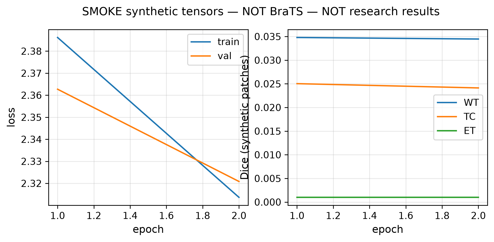

# Experimental results (Phase 5)

**This software is a research prototype, not a clinically validated diagnostic tool.**

Generated: `2026-11-17T12:01:48.853881+00:00` from on-disk `experiments/` JSON only. Missing measurements are written as **not measured**. No leaderboard number, no paper table, and no synthetic smoke Dice was copied into the comparison tables.

## Verdict on recorded evidence

- Research-eligible test evaluations (non-smoke `metrics_test.json`): **0**
- Synthetic smoke folders: **1**
- Official BraTS A vs B vs C comparison: **not measured**
- No improvement of the proposed method over the baseline is claimed.

## Actual recorded runs

| Folder | Status | Smoke? | Test metrics? | Device | CUDA | Epochs |
| --- | --- | --- | --- | --- | --- | --- |
| smoke | smoke_synthetic_not_research | yes | no | cpu | False | 2.0 |


*Figure 1. Count of folders that actually exist. Not a performance chart.*

## Planned comparison (A / B / C)

Same patient-level split, same preprocessing YAML, same patch size, as in `docs/evaluation_protocol.md`. Cells stay empty until the named run has a non-smoke `metrics_test.json`.

| Metric | A: 3D U-Net baseline | B: Attention U-Net | C: Proposed (SE + ET boundary + MC dropout) |
| --- | --- | --- | --- |
| Dice WT | not measured | not measured | not measured |
| Dice TC | not measured | not measured | not measured |
| Dice ET | not measured | not measured | not measured |
| HD95 WT | not measured | not measured | not measured |
| HD95 TC | not measured | not measured | not measured |
| HD95 ET | not measured | not measured | not measured |
| Precision ET | not measured | not measured | not measured |
| Recall ET | not measured | not measured | not measured |
| ECE | not measured | not measured | not measured |
| Brier (multiclass) | not measured | not measured | not measured |

### Additional planned metrics

| Metric | Status |
| --- | --- |
| Small-ET Dice (lowest quartile of ET voxels) | not measured |
| Spearman ρ (patient entropy vs ET Dice) | not measured |
| AUPRC for worst ET Dice quartile | not measured |
| Inference latency (ms, T=1 and T=10) | not measured |
| GPU peak allocated MB | not measured |

## Component ablations (from C)

Each arm removes one proposed component. None of these jobs has been started unless a matching non-smoke folder exists.

| Arm | Removes | Train? | dice_et |
| --- | --- | --- | --- |
| C_minus_se | SE fusion | no (reuse ckpt) | not measured |
| C_minus_boundary | ET boundary loss | no (reuse ckpt) | not measured |
| C_minus_mc | MC dropout | no (reuse ckpt) | not measured |

## Failure cases

No failure-case ranking is available. It requires a non-smoke `metrics_test.json` with per-patient Dice on official volumes.

## Multi-seed protocol

Configured seeds: 2026. Additional seeds are **planned** and have not been run. Mean ± std and t-intervals across seeds will be filled only from completed seed folders.

## Limitations

- Official BraTS volumes were not present when this report was generated, so test Dice/HD95/ECE do not exist.
- Phase 4/5 expensive training still requires protocol approval (`expensive_training_requires_approval: true`).
- Smoke Dice is patch-wise on random cubes; it is not comparable to challenge scores.
- GPU memory is undefined on CPU-only machines (`cuda: false`).
- HD95 is NaN when a surface cannot be formed; NaNs are omitted from means, not replaced.
- This is not a clinical validation.

## Reproducibility

Regenerate this file (still without inventing metrics) with:

```powershell
.\.venv\Scripts\python scripts\collect_results.py
```

After approved BraTS jobs:

```powershell
.\.venv\Scripts\python scripts\train.py --ablation A0_baseline --run-name A0_baseline
.\.venv\Scripts\python scripts\evaluate.py --run-name A0_baseline
.\.venv\Scripts\python scripts\analyze_reliability.py --run-name A0_baseline --samples 10
.\.venv\Scripts\python scripts\collect_results.py
```

## Appendix: synthetic smoke (not research)

These numbers are **software verification only**. They used random tensors. They are **not** BraTS results and are **not** an A/B/C comparison.

### `smoke`

- status: `smoke_synthetic_not_research`
- device: `cpu`
- CUDA available: `False`
- torch: `2.15.0+cpu`
- epochs_ran: `2.0`
- note: Synthetic tensors only. Not BraTS. Not research results.
- last recorded synthetic val Dice WT/TC/ET: 0.03446688435617582, 0.02412907268170426, 0.0009992521210705151 (random tensors; do not cite)




*Figure A1. Synthetic smoke learning curves. Do not cite as BraTS performance.*
