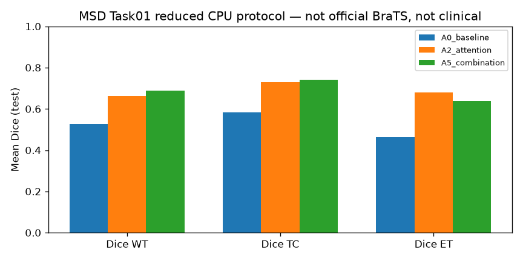
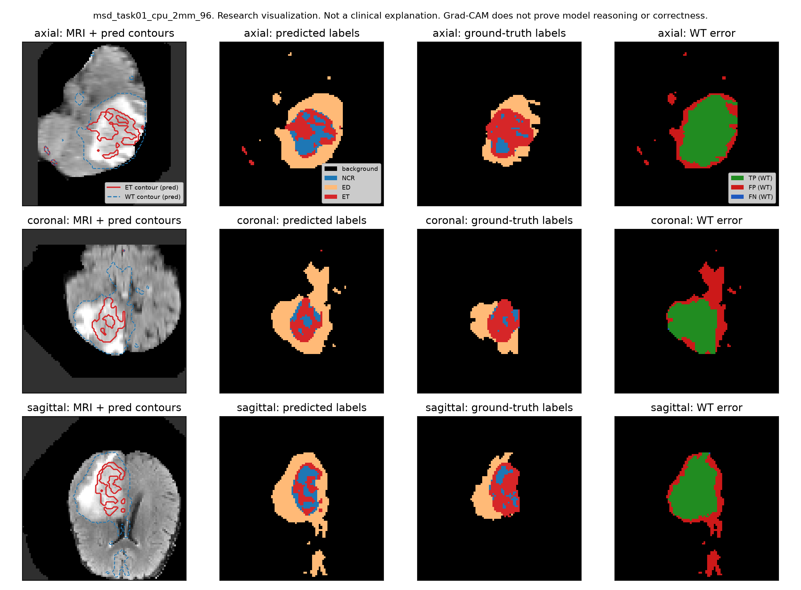
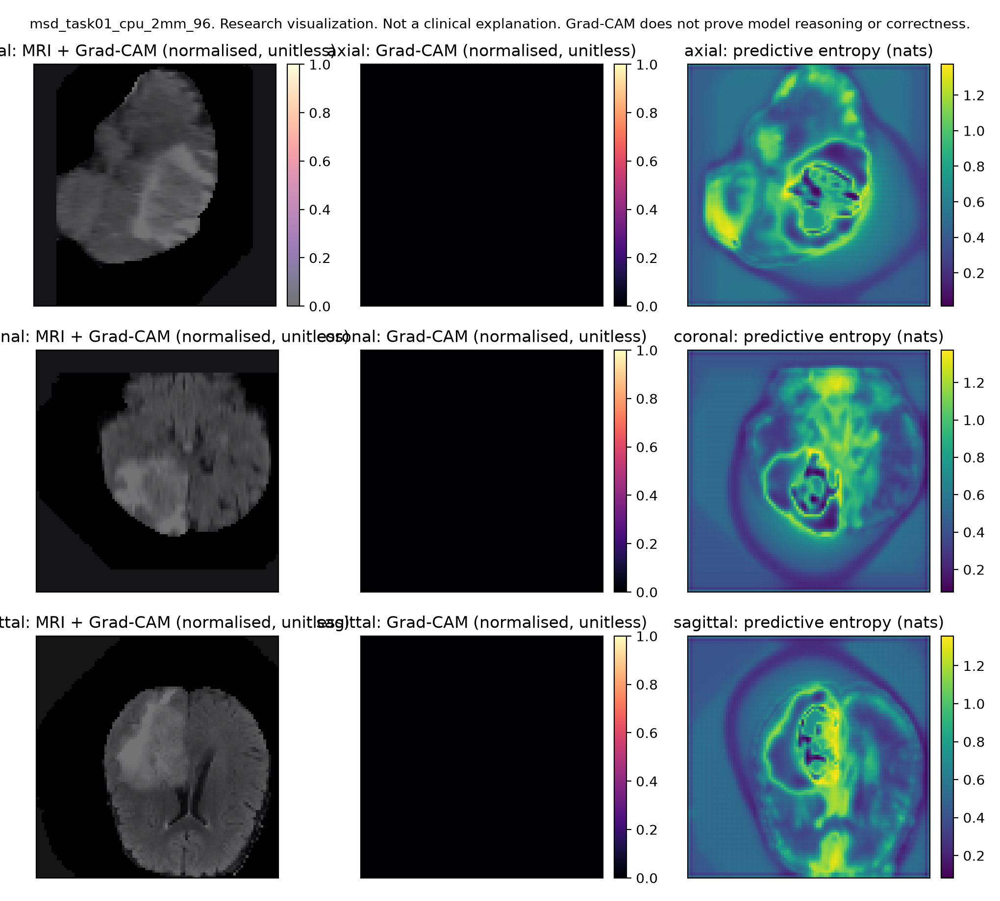
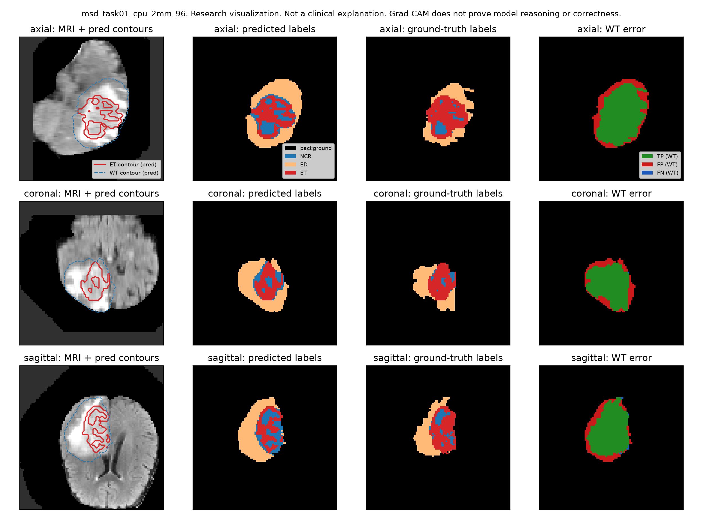
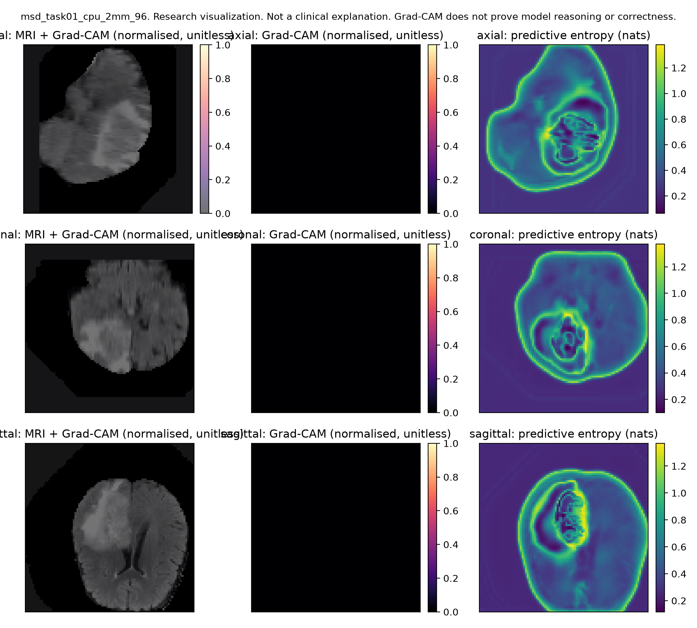
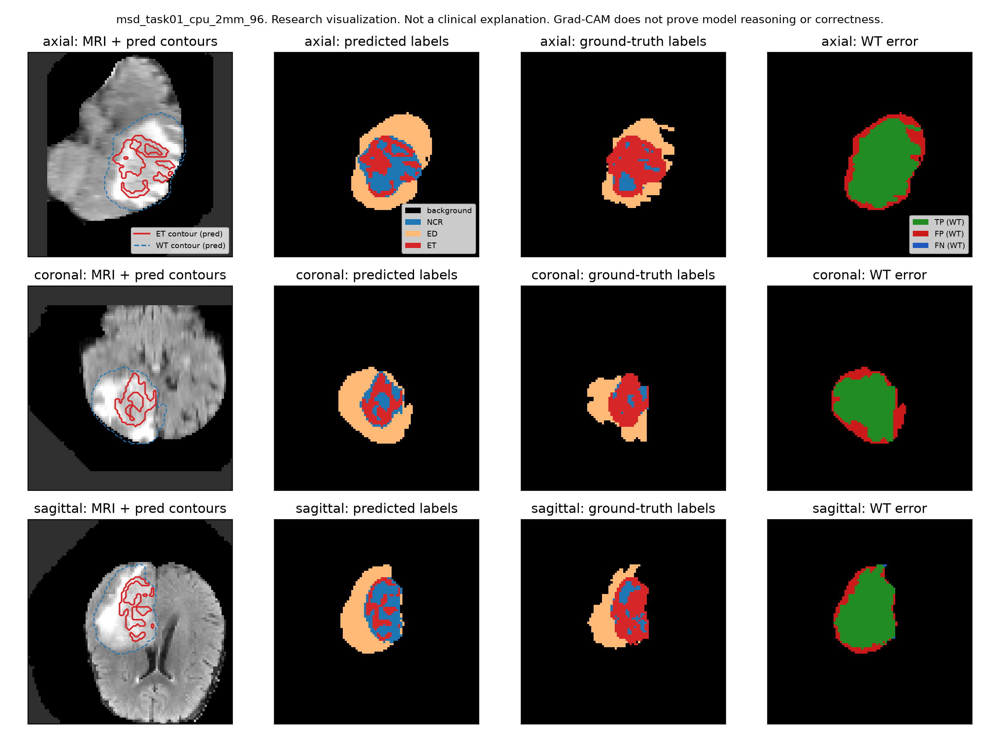
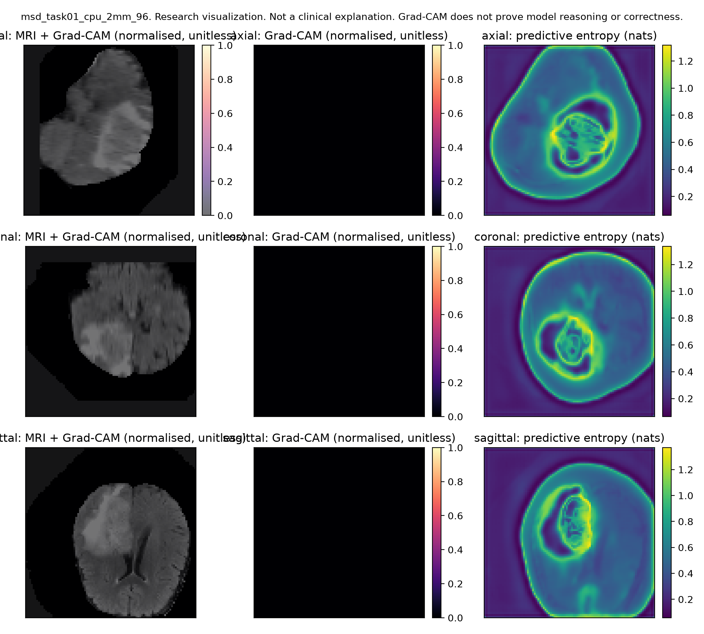
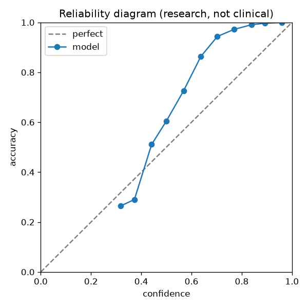
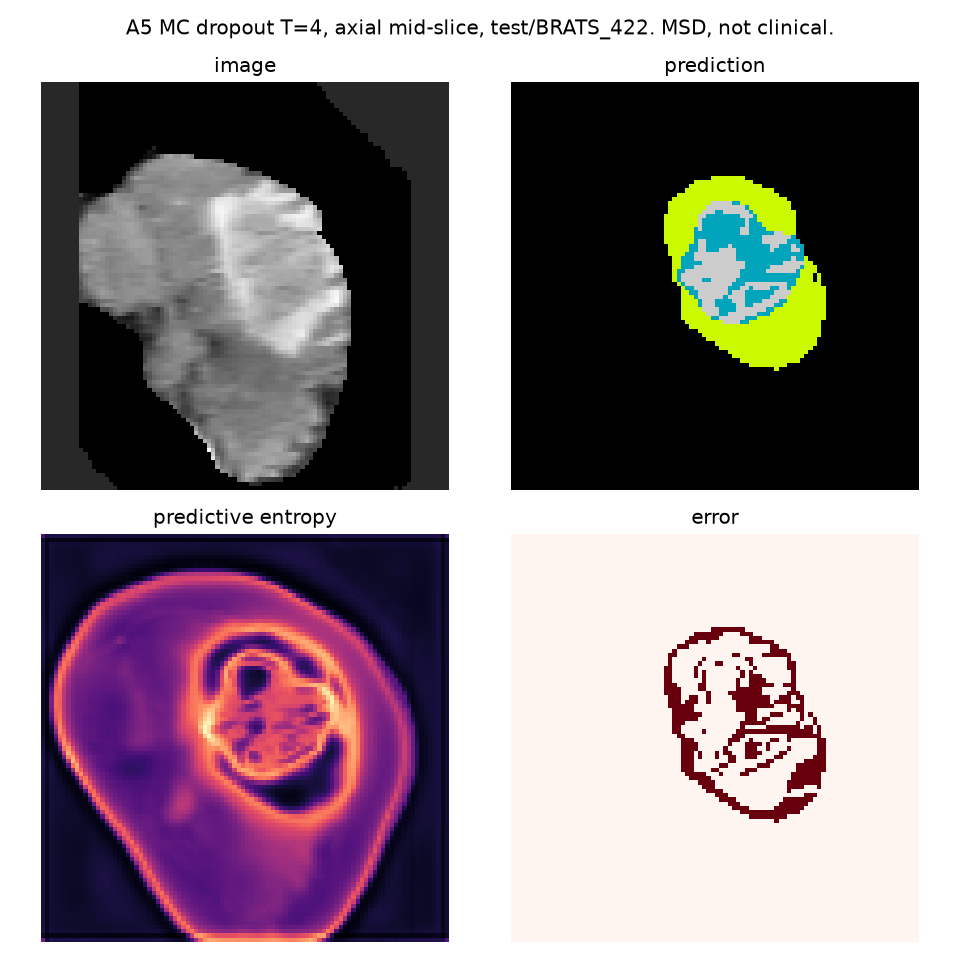

## Measured MSD CPU run (generated from JSON)

Figures and cells in this section were copied from `experiments/` after training. They are **MSD Task01**, reduced CPU protocol (`docs/msd_protocol.md`), **not** official BraTS 2021+ and **not** a clinical validation. Dice cells use `format_summary` (3 decimal places, sample std, Student-t interval). Unrounded values stay in `metrics_test.json`. HD95 is in **voxels** of the 2 mm grid.

### `A0_baseline`

- patients: 12
- inference: `{"method": "deterministic", "mc_samples": 1}`
- spatial: `{"hd95_unit": "voxels", "target_spacing_mm": [2.0, 2.0, 2.0], "note": "HD95 is in voxels of the volume that was scored. Do not relabel it as millimetres unless that spacing is 1 mm."}`
- dice_wt: 0.528 ± 0.238 [0.377, 0.679] (n=12)
- dice_tc: 0.583 ± 0.202 [0.454, 0.711] (n=12)
- dice_et: 0.464 ± 0.281 [0.285, 0.642] (n=12)
- hd95_wt: 26.575 ± 11.197 [19.461, 33.689] (n=12)
- hd95_tc: 32.714 ± 10.189 [26.240, 39.188] (n=12)
- hd95_et: 31.378 ± 10.962 [24.014, 38.742] (n=11)
- ece: 0.109 ± 0.014 [0.100, 0.118] (n=12)
- brier: 0.066 ± 0.017 [0.055, 0.077] (n=12)
- learning curves: `figures/msd_cpu/A0_baseline_learning_curves.png`
- best.pt sha256: `f9fea768469d3e6b21c8535bbf180a7f2db42fb14f44c9c22d02a24c6e80c172`
- best.pt bytes: 16999253

### `A2_attention`

- patients: 12
- inference: `{"method": "deterministic", "mc_samples": 1}`
- spatial: `{"hd95_unit": "voxels", "target_spacing_mm": [2.0, 2.0, 2.0], "note": "HD95 is in voxels of the volume that was scored. Do not relabel it as millimetres unless that spacing is 1 mm."}`
- dice_wt: 0.662 ± 0.190 [0.541, 0.783] (n=12)
- dice_tc: 0.729 ± 0.149 [0.634, 0.824] (n=12)
- dice_et: 0.680 ± 0.257 [0.517, 0.843] (n=12)
- hd95_wt: 9.203 ± 7.775 [4.263, 14.143] (n=12)
- hd95_tc: 12.081 ± 12.182 [4.340, 19.821] (n=12)
- hd95_et: 7.933 ± 11.982 [-0.117, 15.983] (n=11)
- ece: 0.075 ± 0.005 [0.073, 0.078] (n=12)
- brier: 0.041 ± 0.008 [0.036, 0.046] (n=12)
- learning curves: `figures/msd_cpu/A2_attention_learning_curves.png`
- best.pt sha256: `6883c13894b6591fd8c46e7c95e730851fbe249327db3d7093edca6a2d89d1a3`
- best.pt bytes: 17086149

### `A5_combination`

- patients: 12
- inference: `{"method": "mc_dropout", "mc_samples": 10}`
- spatial: `{"hd95_unit": "voxels", "target_spacing_mm": [2.0, 2.0, 2.0], "note": "HD95 is in voxels of the volume that was scored. Do not relabel it as millimetres unless that spacing is 1 mm."}`
- dice_wt: 0.690 ± 0.154 [0.592, 0.788] (n=12)
- dice_tc: 0.740 ± 0.143 [0.650, 0.831] (n=12)
- dice_et: 0.638 ± 0.253 [0.477, 0.799] (n=12)
- hd95_wt: 13.176 ± 10.727 [6.360, 19.991] (n=12)
- hd95_tc: 12.153 ± 15.035 [2.600, 21.705] (n=12)
- hd95_et: 4.441 ± 6.099 [0.344, 8.539] (n=11)
- ece: 0.081 ± 0.004 [0.079, 0.083] (n=12)
- brier: 0.040 ± 0.006 [0.036, 0.044] (n=12)
- learning curves: `figures/msd_cpu/A5_combination_learning_curves.png`
- best.pt sha256: `4be1e938f2d2e816a938f7a54a8f43c68cfdf4c43a3baaef03b9bdbffddd1c11`
- best.pt bytes: 17004677

*Mean test Dice on the reduced MSD cohort. Not a BraTS leaderboard chart.*

*A0_baseline: FLAIR with prediction overlay from the checkpoint forward. MSD cohort, not clinical.*

*A2_attention: FLAIR with prediction overlay from the checkpoint forward. MSD cohort, not clinical.*

*A5_combination: FLAIR with prediction overlay from the checkpoint forward. MSD cohort, not clinical.*

*A5 MC-dropout entropy on an axial slice of `test/BRATS_422` (T=4 for this figure; test metrics use T=10). Not a clinical confidence map.*

### Reading the numbers

- HD95 is in voxels of the 2 mm grid. One voxel is 2 mm, so a millimetre figure is the voxel mean times 2. That product is derived, not a second measurement.
- `test/BRATS_026` has no enhancing-tumor surface, so HD95 ET is NaN and is omitted (n=11). Dice ET for an empty reference is still included (n=12).
- A Student-t interval can cross zero when the standard deviation is large and n is small (A2 HD95 ET). The distances themselves are not negative.
- A5 Spearman ρ (patient entropy vs ET Dice) on this split is positive and the p-value is large. H2 is not supported here. A0/A2 entropy is T=1, not MC dropout.
- Component ablations C−SE, C−boundary, and C−MC were not run. A vs B vs C is one seed (2026) on 12 test patients. No method is claimed to be better in general.
